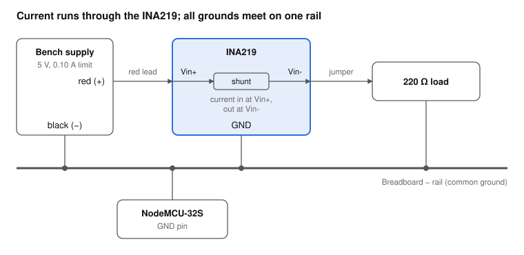

# ESP32 + INA219 Power & Sensing Bench Lab

[](https://github.com/YOUR_USERNAME/esp32-ina219-bench-lab/actions/workflows/ci.yml)
[](LICENSE)


A hands-on lab series that characterizes a low-cost measurement setup before trusting it: an **INA219** current/power monitor read by an **ESP32**, checked against a bench supply and a multimeter, then used to profile real components.

The idea: the **INA219 is the instrument**, the **ESP32 is the controller and logger**, the **Elegoo kit parts are the devices under test**, and the **bench supply is the stimulus**. Each lab starts by asking how far the instrument can be trusted.



## Results so far (Lab 0)

Measured with a 220 ohm resistor at 5 V. Full data and method in [`labs/lab0-bring-up/RESULTS.md`](labs/lab0-bring-up/RESULTS.md).

| Source | Current | Error vs reference (22.36 mA) |
|---|---|---|
| Multimeter (V / R) | 22.36 mA | reference |
| INA219, 5-sample mean | 22.40 mA | +0.2% |
| Bench supply display | 21 mA | -6% |

- The INA219 agreed with the meter-derived reference to within noise. Single readings varied by about 0.2 mA (two shunt counts), so averaging matters.
- The supply's current display reads low and is only a rough indicator.
- An unresolved 63 mV gap between the INA219 bus voltage and the voltage across the resistor is documented as an open item, with the test that will resolve it.
- Two measurement pitfalls were caught and written up: swapped Vin+/Vin- (negative current of the right magnitude) and an in-circuit resistance reading of 164 ohm for a 220 ohm part.

## Labs

| Lab | Topic | Status |
|---|---|---|
| [0](labs/lab0-bring-up/) | Bring-up: I2C scan, zero offset, first load cross-check | Complete (two measurements pending, listed in the results) |
| [1](labs/lab1-characterize-instrument/) | Characterize the instrument: accuracy, noise, averaging, gain range, ESP32 ADC | Instructions, firmware and analysis ready; measurements pending |
| 2 | Component I-V curves (LEDs, diodes, resistors, thermistor, RC) | Planned |
| 3 | Power profiling (ESP32 modes, motor, servo, stepper, relay) | Planned |
| 4 | The bench supply under stress (regulation, CC knee, MB102 efficiency) | Planned |
| 5 | Capstones (I-V tracer, Wi-Fi power logger, current limiter) | Planned |

Details for every lab are in [`docs/roadmap.md`](docs/roadmap.md).

## Skills demonstrated

- **Embedded firmware:** I2C bring-up and sensor reads on the ESP32 in Arduino C++, with selectable human-readable or CSV serial output.
- **Measurement discipline:** independent reference instruments, uncertainty reasoning, noise versus resolution, and honest reporting of unexplained results.
- **Data analysis:** Python tools (standard library only, unit tested) that parse captures, report mean, standard deviation, sample rate and percent error, and fit gain and offset error.
- **Low-level hardware access:** Lab 1 firmware configures the INA219 through its registers directly (gain, ADC resolution and averaging) rather than relying on a library.
- **Engineering hygiene:** continuous integration that runs the tests and compiles the firmware, safety rules for working with a 10 A supply, and a reproducible lab write-up format.

## Hardware

| Item | Used in this repo |
|---|---|
| Microcontroller | NodeMCU-32S (ESP32-S) |
| Current/power monitor | INA219 breakout (I2C, default address 0x40) |
| Bench supply | Jesverity SPS-3010 (0-30 V, 0-10 A switching supply) |
| Parts kit | Elegoo Super Starter Kit |
| Software | Arduino IDE with the ESP32 board package, Adafruit INA219 library, Python 3.8+ (standard library only) |

Other ESP32 boards and bench supplies should work with small changes to pin numbers and the supply's current-limit procedure.

## Quick start

1. Install the Arduino IDE, add the ESP32 board package, and install the **Adafruit INA219** library.
2. Upload `labs/lab0-bring-up/firmware/i2c_scan/i2c_scan.ino` and confirm the INA219 appears at `0x40`.
3. Follow the [Lab 0 instructions](labs/lab0-bring-up/README.md).
4. Analyze a capture:

```
python labs/lab0-bring-up/analysis/analyze_log.py labs/lab0-bring-up/data/sample_load.log --ohms 220 --ref-volts 4.92
```

Run the tests:

```
python -m unittest discover -s labs/lab0-bring-up/analysis -v
python -m unittest discover -s labs/lab1-characterize-instrument/analysis -v
```

## Repository layout

```
.
├── README.md
├── CHANGELOG.md
├── LICENSE
├── .github/workflows/ci.yml        # tests + firmware compile
├── docs/
│   └── roadmap.md                  # plan for Labs 1-5
└── labs/
    ├── lab0-bring-up/
    │   ├── README.md               # instructions
    │   ├── RESULTS.md              # measured data and findings
    │   ├── firmware/               # i2c_scan, ina219_logger
    │   ├── analysis/               # analyze_log.py + tests
    │   ├── data/
    │   └── images/wiring.svg
    └── lab1-characterize-instrument/
        ├── README.md               # instructions (with a beginner primer)
        ├── RESULTS.md              # template, filled in as data is taken
        ├── firmware/               # ina219_characterize, adc_vs_ina219
        ├── analysis/               # analyze_lab1.py, fit_accuracy.py + tests
        └── data/
```

## Safety

- Set the supply's **current limit before connecting anything**.
- The INA219 is rated to about 26 V on its bus input and about 3.2 A through its shunt. A 10 A supply can destroy it if the limit is set high.
- ESP32 GPIO pins are **3.3 V only**.
- Turn the supply output **off** before changing wiring.

This is educational material provided as is. You are responsible for your own wiring and equipment.

## License

[MIT](LICENSE)
