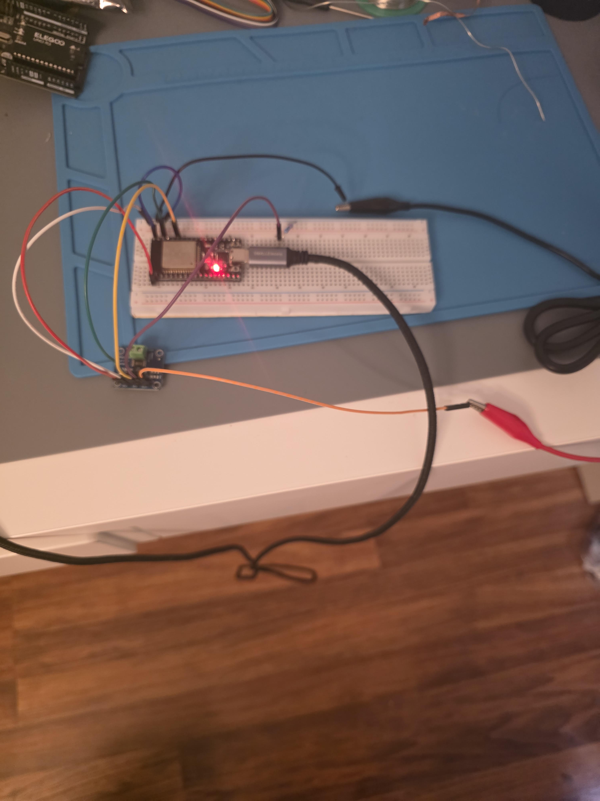

# Lab 0 Results

**Hardware:** NodeMCU-32S, INA219 breakout (address 0x40), Jesverty SPS-3010, 220 ohm resistor, multimeter
**Settings:** supply 5.0 V, 0.10 A current limit; INA219 default configuration (Adafruit library)

## Scanner

The I2C scanner found the INA219 at 0x40.

## Load comparison (5 V into a 220 ohm resistor)

Resistor measured out of circuit: **220 ohm**. Multimeter across the resistor: **4.92 V**. Multimeter at the supply terminals: **5.0 V**.

Reference current = 4.92 V / 220 ohm = **22.36 mA**.

| Source | Voltage | Current | Current error vs reference |
|---|---|---|---|
| Multimeter (V / R) | 4.92 V at resistor | 22.36 mA | reference |
| INA219 (5-sample mean) | 4.983 V bus | 22.40 mA | +0.2% |
| Supply display | 5 V | 21 mA | -6% |

INA219 statistics from [`data/sample_load.log`](data/sample_load.log), produced with `analysis/analyze_log.py`:

| Quantity | Mean | Std dev | Min | Max |
|---|---|---|---|---|
| Bus (V) | 4.983 | 0.002 | 4.980 | 4.984 |
| Shunt (mV) | 2.250 | 0.020 | 2.220 | 2.270 |
| Current (mA) | 22.40 | 0.20 | 22.20 | 22.60 |
| Power (mW) | 112 | 0 | 112 | 112 |

## Findings

1. **Current:** the INA219 matched the meter-derived reference to within noise (+0.2%). Single readings varied by about 0.2 mA, which is two counts of the 10 microvolt shunt resolution, so averaging matters.
2. **Supply display:** voltage agreed with the meter at the terminals; the current readout was about 6% low and should be treated as a rough indicator.
3. **Voltage gap (open item):** the INA219 bus voltage (4.983 V) is about 63 mV above the meter reading across the resistor (4.92 V), while the supply terminals read 5.0 V. Either about 2.8 ohm of jumper and breadboard contact resistance sits between Vin- and the resistor, or the INA219 bus reading is about 1.3% high. Measuring from Vin- to the ground rail will decide it.
4. **Measurement pitfalls found:** a swapped Vin+/Vin- connection produced negative current readings of the correct magnitude, and measuring the resistor in circuit gave 164 ohm instead of 220 ohm because of parallel paths.

## Wiring Photo

